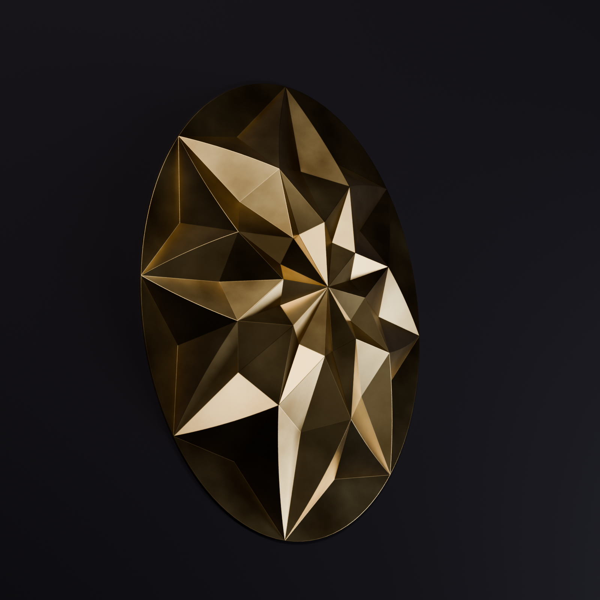

# Masque des séraphins — Sainte-Sophie

Modèle 3D paramétrique du masque-étoile en zinc posé par les Fossati (1847-49) sur les
visages des séraphins des pendentifs de Sainte-Sophie. Exemplaire de référence : celui
exposé au musée Ayasofya Tarih ve Deneyim Müzesi (déposé en 2009, pendentif NE).
Objectif final : une version portable (masque à porter).

English summary: parametric 3D model (pure Python, STL output) of the zinc star-masks placed by
the Fossati brothers (1847-49) over the faces of the seraphim in the pendentives of Hagia Sophia,
fitted by photogrammetry on photos of the specimen shown at the Ayasofya museum.

## Fichiers

- `masque_seraphin.py` — générateur paramétrique (Python pur, aucune dépendance).
  `python3 masque_seraphin.py [--b 100 --ratio 0.65 --hc 35 ...]` → écrit dans `sortie/`.
  Le docstring décrit tous les points (T, R, V, M, P, Q, C) et les facettes.
- `sortie/` — `masque.stl`, `masque_2d.svg` (plis montagne/vallée), `masque_apercu.svg`
  (ombré), `sommets.json`.
- `visionneuse.html` — viewer three.js du STL. Lancer : `python3 -m http.server 8765`
  ouvrir http://localhost:8765/visionneuse.html.
- `analyse/` — scripts de vérification photogrammétrique (Python pur) :
  - `ba.py`, `ba2-4.py` : ajustement de faisceaux sténopé sur la vidéo du musée.
  - `ortho.py` : ajustement orthographique multi-vues (photos téléobjectif).
    `python3 analyse/ortho.py analyse/donnees/star2.json ratio,Zc '{"ratio":0.65}'`
  - `cam.py`, `fit.py` : caméra affine + parallaxe sur une seule image vidéo (origine des
    hauteurs ZV/ZM/ZP du tableau ci-dessous).
  - `homog.py` : homographie des 8 pointes → centre projeté, parallaxe du sommet.
  - `donnees/` : pointés manuels (pixels image d'origine) — vidéo (`obs0.json`),
    étoile 1 photo 5876 (`star1.json`), étoile 2 photo 5880 (`star2.json`).

## Paramètres actuels (unités : b = demi-hauteur = 100 mm) — ajustés le 2026-11-14

Source : ajustement sténopé 2 vues (`analyse/ba2v.py`) sur les pointés précis de l'auteur
(photo frontale A + oblique B du musée, 97 points, rms 4.7 px ; A 2.5 px, B 6.2 px).

| param | valeur | statut |
|---|---|---|
| ratio a/b | 0.705 | ±0.005 formel. Remplace 0.65 |
| partage du bord | 8 arcs égaux (`arcs=1`) | résidus B divisés par 2 (12.9 → 6.2 px) ; angles libres : 40.6°/19.0°/62.4° contre 40.2°/19.5°/63.5° prédits |
| RR / RV / RM / RP / RQ | 0.79 / 0.57 / 0.57 / 0.29 / 0.265 | ±0.005 formel |
| hauteurs absolues V / M / P / Q | 21.7 / 11.3 / 28.7 / 22.2 mm | **bien contraintes** (±1.5 mm ; varient de <3 mm quand HC passe de 31 à 40) |
| HC (sommet C) | 31 mm | **mal contraint** (un seul point) : ±2 formel, rms quasi identique de 29 à 35 mm, 40 mm coûte +0.2 px |
| ZV / ZM / ZP / ZQ (×HC) | 0.70 / 0.365 / 0.925 / 0.715 | dérivés des hauteurs absolues ci-dessus pour HC = 31. Si HC change, garder les mm, pas les rapports |

Résultat : 208 facettes, 128 plis (40 montagne / 88 vallée), STL étanche, ~299 cm³.
Sens des plis vérifié après ajustement : T-M, M-P, M-V, C-Q, Q-V, P-Q, R-V, R-T en vallée ;
C-P, P-V, T-V en montagne (conforme au schéma confirmé au musée).
Résidu restant sur B (T, M, R, Q : 6-7 px ≈ 7 mm sur 1 m) : défauts d'atelier, distorsion de
l'objectif du téléphone ou point principal décentré ; non séparables.
`masque_2d.svg` est une projection, **pas un développé** (longueurs raccourcies, sommets R/V/C
non développables) : ne pas s'en servir comme patron à plier.

Enveloppe en dôme (constat 2026-11-14) : les sommets hauts T, V, P, C suivent z ≈ HC·(1 − r^2.1)
(r = rayon normalisé ; T 0, V 21.7, P 28.7, C 31 mm), soit un quasi-paraboloïde. Avec n = 2 imposé,
V et P donnent HC = 31-32 mm : appui indépendant pour HC ≈ 31. Les creux M, Q, R sont sous ce dôme.
Arêtes courbes (test du 2026-11-14, `analyse/aretes.py`, 47 arêtes pointées au milieu sur la photo
oblique, `donnees/musee_b_aretes.json`) :
- T-M, P-V, C-P : droites (flèche moyenne 1.2-1.5 px = bruit de pointage).
- **Crêtes T-V : courbes.** Flèche 0.5-12.5 px (moy. 6 px, ~3 % de l'arête, jusqu'à 6 %), signe
  systématique sur les 16 : le milieu de la crête s'écarte de l'axe de sa branche (vers l'encoche R).
  Les deux côtés d'une branche sont cintrés en miroir → branche en « feuille ».
- Tranché par la photo frontale (48 arêtes, `donnees/musee_a_aretes.json`) : crêtes T-V cintrées
  **en plan**, flèche +2.3 ± 0.3 px sur 80 px = **2.8 % de l'arête** (15 arêtes sur 16 du même
  signe), contre 3.3 % sur l'oblique → l'essentiel est latéral ; composante en hauteur ≤ ~1 %,
  non mesurable. Les trois autres familles restent droites sur A aussi (0.3-0.7 px).
  Échelle : ~1.4 mm sur le modèle 200 mm, ~7 mm sur un masque d'1 m.
- Un seul point par arête : courbe régulière ou cassure au milieu, non distingué.
- **Décision de l'auteur : courbes propres et continues, jamais de cassure.** Implémenté en option
  `--fleche 0.028` (défaut 0 = polyèdre pur) : crête T-V = arc de parabole plan
  X(t) = (1−t)T + tV + 4·f·L·t(1−t)·n (Bézier quadratique, n = normale horizontale côté encoche,
  z linéaire) ; les 4 facettes voisines deviennent des portions de cône de sommet M ou R
  (lisses, développables). `--seg` = segments par crête (16). Variante générée dans
  `sortie_cintre/` : étanche, 128 plis inchangés, 1.3° max entre triangles d'un même cône.

## Décisions et constats

- Les 8 losanges centraux sont **creux, 4 facettes** autour de Q (choix de l'auteur,
  vérifié sur photos). Ne pas revenir au losange plat à 2 faces.
- **Le schéma des plis est confirmé de visu au musée par l'auteur** (rayons en gouttière
  T-M-P, chevron V-M-V, épaules R-V, losanges creux). Ne pas le remettre en cause, même si
  l'ombrage des photos du plafond semble dire le contraire (dorure spéculaire, lumière
  diffuse : non fiable). Seuls restent à affiner : les profondeurs (HC, ZV/ZM/ZP/ZQ), le
  ratio a/b et la courbure d'ensemble.
- La vidéo du musée (téléphone, focale inconnue) ne permet pas de fixer HC : ambiguïté
  profondeur/focale.
- Étoiles encore au plafond (Commons, Nikon 165-180 mm, ~35-40 m) : même dessin exact,
  mais rapport apparent 0.70-0.81 et parallaxe du sommet 0.04-0.10·b, incohérents entre eux
  → ne valident ni n'invalident HC. Modèle laissé inchangé.
- Taille réelle du masque inconnue : séraphin ≈ 1.5 × 1 m, masque probablement ~0.8-1 m de haut
  (estimation grossière). Pour lever le doute sur HC : photo de profil ou mesure au musée.

## Partage du bord en 8 arcs égaux (2026-11-14)

- Pointé précis de la photo frontale musée par l'auteur (`pointage.html`, 49 points,
  ±1-2 px) : `analyse/donnees/musee_a_precis.json`, contrôle par `analyse/verif_pointage.py`.
- Pointes diagonales mesurées à 50-51° réels de l'horizontale (cercle étiré : 55° ; octogone
  régulier : 45°). Cohérent avec un bord partagé en **8 arcs de longueur égale** : prédit 40,2°
  paramétrique (mesuré 39-40°) et encoches R à 19,5°/63,5° (mesuré 17-20°/60-64°).
  Appliqué au générateur : paramètre `arcs=1` (défaut) ; `--arcs 0` redonne l'ancien modèle.
  Une seule photo : à recouper avec la photo oblique.
- Rayons mesurés sur cette photo (unités affines, moyenne des 8) : RM 0.59, RP 0.30, RV 0.60,
  RR 0.80, RQ 0.28 ; a/b apparent 0.692 (caméra en légère contre-plongée → vrai ≈ 0.68-0.69).
  **Non appliqués** (modèle : 0.60/0.29/0.57/0.76/0.32, ratio 0.65) : attendre la photo oblique.
  L'ancien « RM 0.48-0.55 » venait du pointé grossier : caduc.
- Défauts d'atelier possibles (ex. plis qui ne se rejoignent pas en M0, vu par l'auteur) :
  non tranchable à 600×900. Objectif = forme idéale symétrisée, pas copie des défauts.
- `pointage.html` : outil de pointage (zoom, loupe, export JSON).
- Thèse Diker : dépôt MSGSÜ en maintenance le 2026-11-14, YÖK sans PDF public. Résumé lu :
  histoire générale des restaurations sur archives, peu de chances d'y trouver la géométrie.

## Points ouverts (vérification du 2026-11-14)

- **Profondeurs** : non tranchables avec les données actuelles. HC : 0.33-0.37·b (affine 1 image)
  contre 0.38-0.45·b (BA 3 images, couplé à la focale). ZM : 0.35-0.42 (affine) contre ≈0.60
  (BA, un seul point M). Valeurs actuelles conservées ; à trancher par photo de profil ou
  mesure au musée.
- **Courbure d'ensemble** (plaque bombée pour épouser le pendentif ?) : aucune donnée ;
  flèche théorique ~8 mm sur 1 m pour un rayon de 15 m, négligeable à l'échelle 200 mm.
- Le docstring disait « chevron V-M-V montagne » : numériquement ce pli est une vallée de 9°
  (texte corrigé, géométrie inchangée).
- Photos Commons non encore exploitées : 5877-5879 (étoile 1 paysage), 5886/5887/5953/5954
  (étoile 1 avant restauration), 6319 (2018, lumière diffuse, peu contrastée), et les deux
  « Seraphim Iconas … Diker in 2010 » qui montrent le visage découvert (utile pour la taille
  réelle du masque par rapport au visage de la mosaïque).
- La vidéo YouTube n'est plus consultable sans compte (anti-bot) ; les frames pointées ne
  sont pas dans le dépôt. En conserver des captures locales si une re-mesure est prévue.

## Sources

### Photos du masque au musée (trouvées le 2026-11-14, non encore pointées proprement)
- Vue quasi frontale, pro, 600×900 : https://img.piri.net/piri/upload/3/2024/5/22/9af35abe-5da37f60-af34-473d-add4-7818c25ab6aa.jpeg
  (galerie Yeni Şafak, mai 2024). Pointé à l'œil sur capture (±5 px) dans
  `analyse/donnees/musee_a.json` (pixels image). Rapport apparent 0.69 (pointes des axes) à 0.75
  (ajustement des 8 pointes : les pointes diagonales sortent de l'ellipse passant par les 4 pointes
  d'axe → vérifier si T0/T4 touchent vraiment le bord). Caméra légèrement en contre-plongée
  → vrai a/b ≈ 0.67-0.72. RM mesuré 0.48-0.55 (modèle 0.60, BA 0.56), RP 0.26-0.34.
  **À refaire au pixel** (GIMP/Aperçu) avant d'en tirer une correction.
- Vue oblique ~45°, 1200×1600, relief et rebord bien visibles (trous de fixation sur le rebord) :
  https://ayasofyagunlugu.wordpress.com/wp-content/uploads/2025/01/535b673e-a530-4c36-818b-da5ef1cfe0e8.jpg
  (blog Ayasofya Günlüğü, janv. 2025). C'est la meilleure source pour HC et ZV/ZM/ZP par parallaxe
  (`cam.py` ou BA à 2 vues avec la frontale ci-dessus). Attention perspective : téléphone à ~1-1.5 m,
  le modèle affine/ortho ne suffit pas ; utiliser `ba.py` (sténopé). Pointé grossier (±10-20 px)
  dans `analyse/donnees/musee_b.json` : résidus 30-50 px, inexploitable en l'état. Points à pointer :
  T0-T7, C, puis M (bout de gouttière), V (épaules), P (étoile centrale) ; `obs0.json` montre le format.
- Taille réelle : dans la frontale, hauteur du masque ≈ 1.2 × largeur de l'album Fossati ouvert
  (in-folio ~82 cm ouvert) → masque ≈ 1 m de haut (±15 %), plutôt haut de la fourchette.
- Le musée appelle l'objet « bronze medallion » / « rozet » ; la presse 2009 dit zinc.

### Pistes documentaires non ouvertes
- Thèse Diker 2010 (MSGSÜ), PDF libre : https://acikerisim.msgsu.edu.tr/xmlui/bitstream/handle/20.500.14124/3505/254340.pdf
  (trop lourd pour WebFetch ; à télécharger et chercher « serafim », « maske », « çinko »).
- Salzenberg 1854, planches (séraphin relevé avec le visage, échelle) : http://suw.biblos.pk.edu.pl/resources/i5/i1/i4/i0/r5140/KortumC_AltChristliche.pdf
- Teteriatnikov 1998, *Mosaics of Hagia Sophia, Istanbul: the Fossati Restoration* (Dumbarton Oaks) ;
  Teteriatnikov & Daskas 2017, catalogue des aquarelles Fossati (DOS 47, p. 301-327).
- Fossati/Haghe 1852, *Aya Sofia*, 25 planches (V&A O514637-42) : étoiles visibles sur les pendentifs.

- Vidéo musée : YouTube `IfUzFmLskxk`.
- https://commons.wikimedia.org/wiki/Category:Seraphim_in_Hagia_Sophia
  (fichiers 5876, 5880, 5881, 6319, 4632).
- Masque en zinc : Diker (article DergiPark, PDF non extractible).

## Rendu photoréaliste (2026-11-14)

- `rendu/rendu_blender.py` : Blender 5.2 (installé, `/opt/homebrew/bin/blender`), Cycles GPU Metal,
  laiton doré patiné, fond velours, 4 vues (face, trois_quarts, rasante, profil).
  `blender -b -P rendu/rendu_blender.py -- [--stl sortie_cintre/masque.stl] [--samples 128] [--res 1600] [--blend rendu/masque.blend]`
  ~2 min pour 4 vues à 1600 px / 128 échantillons sur M1 Pro. Images dans `rendu/images/`.
  `rendu/masque.blend` : scène à ouvrir dans Blender pour tourner autour librement.

## Version portable — décisions de l'auteur (2026-11-14)

- Fabrication : **impression 3D d'abord** ; à terme **version bronze confiée à un bronzier**
  (fonte à la cire perdue : prévoir épaisseur ~2.5-3 mm, retrait ~1.5-2 %, poids, modèle
  imprimable en résine calcinable ou PLA pour le moulage).
- Couverture : **visage entier** (le modèle à b = 100 fait déjà 200 × 141 mm ≈ un visage).
- Vision : **garder deux variantes** — fentes le long des plis, et facettes ajourées.
- Attache : **rubans** pour la première version (passants sur le rebord).
- Constat : à cette échelle, les yeux (±31 mm, ~+15 mm au-dessus du centre) tombent près des
  sommets V1/V7 (épaules, 21.7 mm de haut) ; le nez loge sous le dôme central (C 31 mm).
  Le rebord plat ne suit pas le visage : courber l'étoile sur une surface de visage
  (cylindre/ellipsoïde) est le premier chantier.
